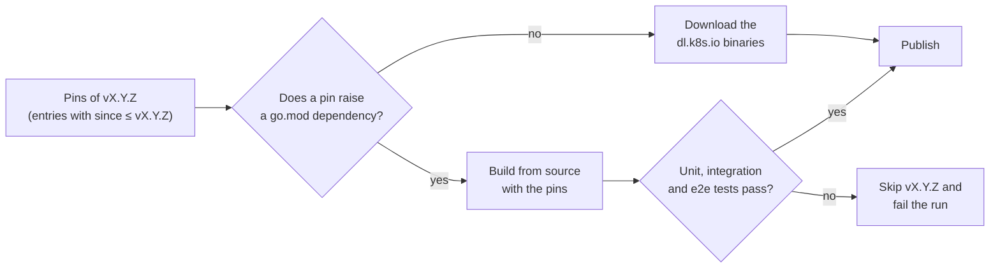

# Kubernetes Container

This project provides a unified container image that bundles the core Kubernetes control plane components (kube-apiserver, kube-controller-manager, and kube-scheduler) into a single, lightweight Alpine-based image.

## Overview

The Kubernetes Control Plane Container offers:

- **Unified packaging**: All core control plane components in one container
- **Multi-architecture support**: Built for both `linux/amd64` and `linux/arm64`
- **Version tracking**: Automated daily builds for all stable Kubernetes releases
- **Minimal footprint**: Based on Alpine Linux for a smaller image size
- **Non-root execution**: Runs as a non-privileged user for enhanced security

## Available Images

Images are published to the GitHub Container Registry:

```
ghcr.io/loft-sh/kubernetes:v1.x.y
```

Where `v1.x.y` corresponds to the Kubernetes version.

## Usage

You can pull the image using:

```bash
docker pull ghcr.io/loft-sh/kubernetes:v1.28.0
```

## Building Locally

### Prerequisites

- Docker with buildx support
- Make

### Build Commands

Build the image locally:

```bash
make build
```

Build for a specific Kubernetes version:

```bash
make build K8S_VERSION=v1.29.0
```

Push to a registry:

```bash
make push REGISTRY=myregistry.io/ IMAGE_NAME=kubernetes
```

## Configuration Options

The build process can be customized with the following variables:

| Variable | Description | Default |
|----------|-------------|---------|
| K8S_VERSION | Kubernetes version to build | v1.28.0 |
| PLATFORMS | Target architectures | linux/amd64,linux/arm64 |
| IMAGE_NAME | Name of the container image | kubernetes-control-plane |
| REGISTRY | Container registry prefix | (empty) |

## Automated Builds

A GitHub Actions workflow runs daily to:

1. Identify all stable Kubernetes releases
2. Check for missing versions in the container registry
3. Automatically build and push images for any missing versions

## Go Dependency Pins (CVE Fixes)

When a scan reports a CVE in a Go dependency of the Kubernetes binaries that upstream has not fixed yet, pin the fixed version in the overlay of that minor version, `hack/kubernetes-v1.X`. The pins are a bash array, one `<since>:<module>@<version>` per line, with the CVE as a comment:

```bash
K8S_GO_DEP_PINS=(
  v1.36.6:golang.org/x/net@v0.62.0        # CVE-2026-39821
  v1.36.7:google.golang.org/grpc@v1.83.2  # CVE-2026-84304
)
```

> **Note:** this format will soon change to YAML, for readability and so that other components can read the overlays too.

Most overlays end without a trailing newline, so start the pins on a new line rather than appending them to the last one.

How the pins apply, in short: **an entry applies to its `<since>` patch release and to every later patch release of that minor version, never to earlier ones.** With the example above:

| Version | Pins |
| --- | --- |
| v1.36.5 and earlier | none: the dl.k8s.io binaries, unchanged |
| v1.36.6 | `golang.org/x/net` |
| v1.36.7, v1.36.8, ... | `golang.org/x/net` and `google.golang.org/grpc` |

How the regular release builds a patch release:



The FIPS build always compiles from source and applies the same pins, but its releases are not tested yet: the tests build their own, non-FIPS binaries.

- New patch releases, which the daily build picks up on its own, inherit the pins of earlier entries, so a fix carries over without a new entry. A pin is a minimum version: `hack/pin-deps/pin-go-deps.sh` skips it where upstream already ships the same or a newer version, so a pin never downgrades and stops applying once upstream catches up (the build log says it can be removed). When the same module is pinned more than once, the highest version wins. `hack/pin-deps/pins-for.sh v1.36.7` prints the pins of a version.
- Moving an entry's `<since>` to an earlier version gives the pins to the patch releases in between too; the pull request gate tests only the new `<since>` and the latest patch release, and the others get their e2e tests when the release rebuilds them.
- A pin must name a module the Kubernetes version depends on and a release version (`vX.Y.Z`, not a pre-release or pseudo-version), and `<since>` must be a patch release of that minor version; otherwise the build fails. The pull request gate also fails for a `<since>` that is not released yet, since no released version could test its pins.
- When a pin raises a dependency of the version being built, the regular build compiles kube-apiserver, kube-controller-manager, kube-scheduler, kubelet, kubeadm and kubectl from source (`hack/pin-deps/Dockerfile`) instead of downloading them from dl.k8s.io; a version no pin applies to, or that already ships every pinned version, keeps the dl.k8s.io binaries. Before a version built from source is published, `release.yaml` runs the same unit, integration and e2e tests as the pull request gate on it, one after another (`hack/pin-deps/ci.sh release-tests`); a version that fails one is not published, and the e2e results are uploaded as the `release-e2e-<version>` artifact. The tests build their own amd64 binaries, and kind its own node image, from the same source, pins and toolchain, so they cover the code that is published rather than the published binaries themselves.
- Pins cover only the Kubernetes binaries. For containerd, runc, etcd, helm and the rest, bump their version in the overlay.
- A pull request that changes the pins runs `.github/workflows/test-go-dep-pins.yaml` before anything is published, on the `<since>` patch release of each new or changed entry and on the latest patch release of that minor version, which inherits every entry. Each, with its pins applied and the Go version it builds with (`.go-version`), must first reach no known vulnerability (`hack/pin-deps/ci.sh vulncheck`, govulncheck on the six Kubernetes binaries; the job summary lists each remaining one with the version to pin), then pass the Kubernetes unit tests (`hack/pin-deps/ci.sh unit`, `make test`), the integration tests (`hack/pin-deps/ci.sh integration`: the API server and controllers against a real etcd, as upstream's `pull-kubernetes-integration`) and the e2e tests on kind (`hack/pin-deps/ci.sh e2e`: the specs of upstream's `pull-kubernetes-e2e-kind` presubmit plus the whole conformance suite), which run in parallel on `large-8_32` runners; the e2e specs also run in parallel, with the `[Serial]` ones one at a time. Vulnerabilities in the Go standard library fail the check too, on purpose: no pin can fix them, so a new Go CVE holds up pin changes for that minor version until Kubernetes releases a patch with a fixed Go. Run it manually for any version, with or without pins, with `gh workflow run test-go-dep-pins.yaml -f k8s-version=v1.36.6` (or `v1.36` for its latest patch release); add `-f vulncheck-only=true` to only scan it for vulnerabilities, e.g. to find what to pin.
- Existing releases are not rebuilt automatically. After a pin change is merged, rebuild the patch releases the pull request tested, by running the `Kubernetes` and `Kubernetes FIPS` workflows with `kubernetes_version`:

  ```bash
  gh workflow run release.yaml -f kubernetes_version=v1.36.7
  gh workflow run release_fips.yaml -f kubernetes_version=v1.36.7
  ```

  A rebuild with `force` rebuilds every patch release as before, but only the ones a pin applies to are built from source and tested; the others keep the dl.k8s.io binaries. `release.yaml` builds each version in its own job (`hack/release-version.sh`), so one version cannot hold up or time out the others: a version that has pins, which is built from source and tested, runs on a `large-8_32` runner (8 vCPUs, 32 GB RAM, 300 GB disk), the others on `ubuntu-latest`. This holds for the daily build, `force` and `kubernetes_version` alike.

  Add `-f dry_run=true` to go through the whole build, including the tests and the image builds, but publish nothing: no release upload, no image push, and the job gets neither a registry login nor a GitHub token. With `--ref <branch>` it tries out changes to the release itself before they are merged:

  ```bash
  gh workflow run release.yaml --ref <branch> -f kubernetes_version=v1.36.7 -f dry_run=true
  ```

## Maintainer

This project is maintained by [Loft Labs Inc](https://loft.sh)
